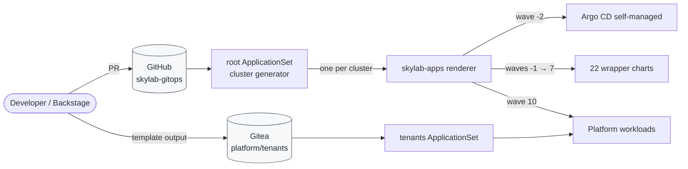

# skylab-gitops

Everything Argo CD syncs on **Skylab** — per-component wrapper charts, a renderer that emits Applications in sync waves, and cluster-as-data placement driven by labels on Argo cluster Secrets.

This is the delivery hub of a four-repo internal developer platform. Argo CD is the only path into the clusters; humans and agents only ever write to Git.

## Architecture



### Three decisions shape the repo

**Wrapper chart per component.** Each `charts/<name>/` depends on the upstream chart and adds its own templates (Namespace, ExternalSecrets, ClusterIssuers, Bundles). No platform-wide umbrella — each component keeps its own health, sync status, and blast radius. Twenty-two wrapper charts today.

**Sync waves instead of appset sprawl.** `charts/skylab-apps/` renders one Application per enabled component with an `argocd.argoproj.io/sync-wave` annotation. A Lua hook in `argocd-cm` re-enables the child-Application health check that Argo CD dropped in 1.8 — without it, waves don't wait on downstream health.

**Cluster-as-data instead of path-based environments.** One root ApplicationSet with a cluster generator renders `skylab-apps` per cluster from labels on that cluster's Argo Secret. Values layer as `values.yaml` → `values-<env>.yaml` → `clusters/<name>.yaml` with `ignoreMissingValueFiles: true`. No `envs/prod/` folders.

### Sync waves

| Wave | Components |
| --- | --- |
| -2 | Argo CD (self-managed) |
| -1 | cert-manager, External Secrets Operator |
| 0 | step-ca, step-issuer, trust-manager, ClusterSecretStores, Kyverno, aws-signing-helper |
| 1 | Crossplane and providers (AWS, GCP, Kubernetes) |
| 2 | `skylab-crossplane` Configuration package |
| 3 | KubeVela, kubevela-defs |
| 4 | Gitea, act_runner |
| 5 | Alloy, kube-prometheus-stack, Loki, Tempo, Grafana, Sloth |
| 6 | Backstage |
| 7 | Model gateway, HolmesGPT, kagent, MCP servers, tack-ai |
| 10 | Workloads |

## Repo map

```
skylab-gitops/
├── bootstrap/          # Argo CD values + root ApplicationSet — applied once per cluster
├── clusters/           # one YAML per cluster: labels, enabled components, overrides
├── charts/
│   ├── skylab-apps/    # renderer: emits Applications + AppProjects with wave annotations
│   └── <component>/    # wrapper chart per platform component
├── workloads/          # platform-owned KubeVela Applications (wave 10)
├── dev/                # local k3d bring-up: config + Argo cluster Secret + README
├── docs/               # ADRs + runbooks
├── Taskfile.yml        # dev loop + lint entry points
├── renovate.json5      # OCI / image / action bumps as PRs
├── plan.md             # cross-repo rework plan + current status
└── AGENTS.md           # engineering context for coding agents
```

## Local dev

One command brings up a k3d cluster, installs Argo CD, registers the cluster, and applies the root ApplicationSet:

```sh
task dev:up        # bring up the dev cluster
task dev:ui        # port-forward argocd-server to https://localhost:8080
task dev:password  # print the admin bootstrap password
task dev:status    # list ApplicationSets and Applications
task dev:down      # tear down
```

Full prereqs and the per-cluster component matrix live in [`dev/README.md`](dev/README.md).

## CI

Pull requests that touch `charts/`, `clusters/`, or `bootstrap/` run three checks against every chart:

- **`ct lint`** — enforces `Chart.yaml` version bumps on any file change inside a chart directory.
- **`helm-unittest`** — runs the test suites in each `charts/*/tests/` directory.
- **`kubeconform -strict`** — renders every chart (and `skylab-apps` once per cluster values file) against upstream Kubernetes + CRD schemas.

Dependency updates land as PRs via self-hosted **Renovate** covering Helm OCI charts, container images, and GitHub Actions.

## Cross-repo map

Skylab is split across four GitHub repos plus a Gitea tenant repo:

| Repo | Role |
| --- | --- |
| **skylab-gitops** (this repo) | Everything Argo CD syncs: platform wrapper charts, cluster config, workloads |
| [skylab-terraform](https://github.com/SkylarHoughtonGithub/skylab-terraform) | AWS and GCP foundations: OIDC, workload identity, buckets, Roles Anywhere trust anchor |
| [skylab-backstage](https://github.com/SkylarHoughtonGithub/skylab-backstage) | Backstage app, image, chart, golden-path templates, MCP actions |
| [skylab-crossplane](https://github.com/SkylarHoughtonGithub/skylab-crossplane) | Cloud-agnostic XRDs with AWS and GCP compositions, published as an OCI package and pinned at wave 2 |
| Gitea `platform/tenants` | Scaffolder output: KubeVela Applications and infra requests, watched by a second ApplicationSet |

## Where to go next

- **[`plan.md`](plan.md)** — full rework plan, current status across all four repos, open decisions.
- **[`AGENTS.md`](AGENTS.md)** — engineering context for coding agents working in-repo.
- **[`dev/README.md`](dev/README.md)** — local k3d bring-up, per-cluster component matrix, teardown.
- **[`docs/adr/`](docs/adr/)** — architecture decision records.
